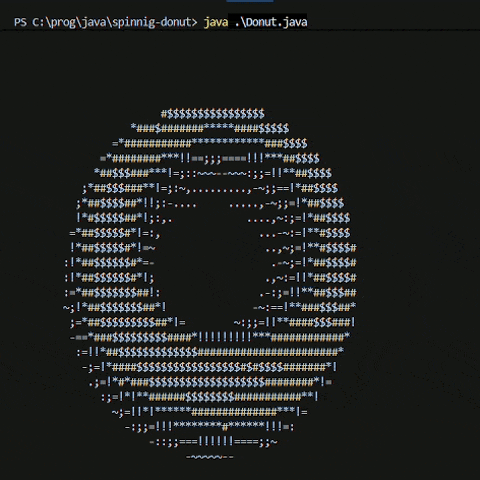

# Крутящийся пончик в терминале на Java



Написано без использования искусственного интеллекта в рамках знаний, полученных при изучении дисциплины "Компьютерная графика".

## Запуск

```
java Donut.java
```

## Кратко что делает код

На каждом кадре строится тор из точек, полученных по параметрическому уравнению. Затем точки проходят преобразования MVP-матрицей и проецируются на экран. Z-буфер отвечает за видимость поверхности, а нормали и направление света используются для расчёта освещения и выбора ASCII-символов.
